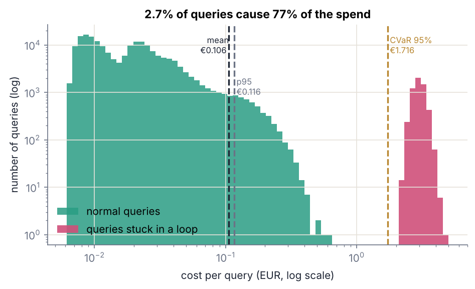
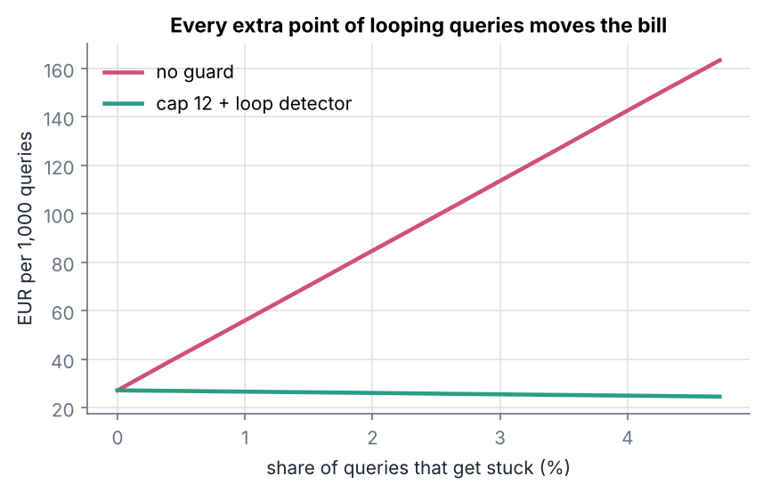
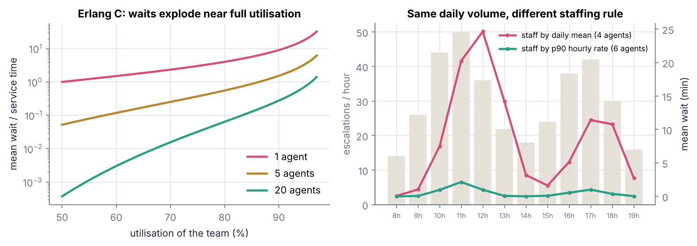
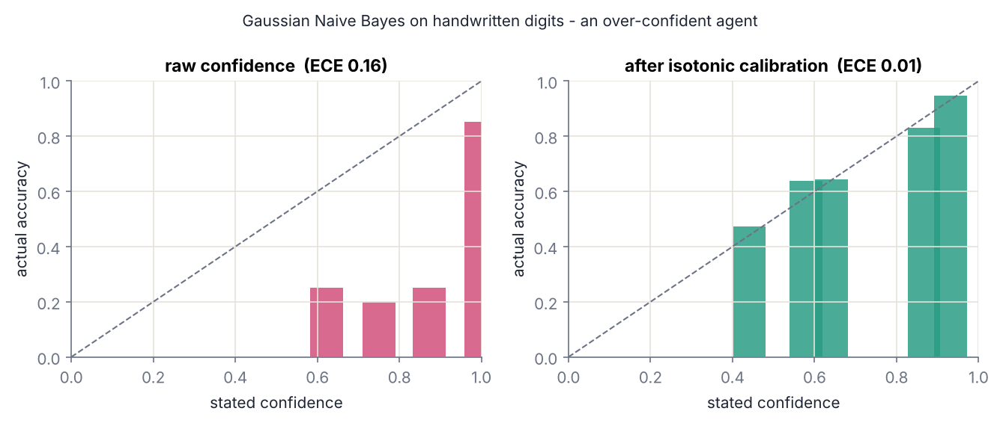
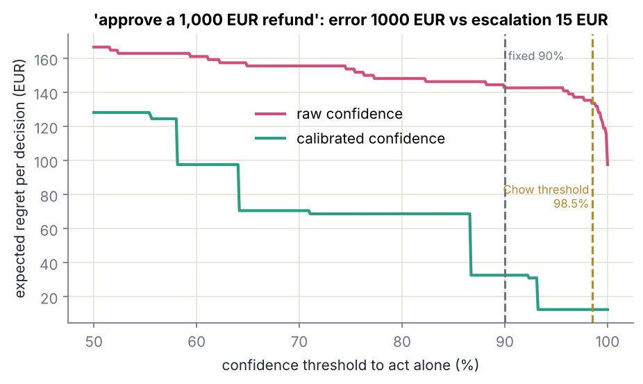

# agents-under-uncertainty

Reproducible experiments on two questions every team running LLM agents in production ends up asking:

1. **What does an agent really cost?** The mean cost per query hides almost everything that matters: heavy tails, loops, and the human team that absorbs the escalations.
2. **When should an agent act on its own, and when should it escalate?** A fixed "act if confidence > 90%" rule ignores the cost of each error and assumes the confidence is calibrated.

Everything runs offline in about 20 seconds. The optional third study measures the *stated* confidence of a real LLM with your own API key.

```bash
pip install -r requirements.txt
make all     # runs studies 1, 1b and 2, writes results/*.json and results/figures/*.png
make test
```

---

## Study 1: the cost of an agent is not its mean

`experiments/01_tail_costs.py` is a Monte Carlo simulation of 200,000 queries to a tool-using agent. At each step the agent re-sends its whole context (system prompt and history), so the cost of a query grows **super-linearly** with its number of steps. Most queries take one or two steps. 8% are hard, and about a third of those get **stuck**: they repeat the same tool call with the same arguments. Prices (3 €/M input tokens, 15 €/M output) and all distributions are explicit, editable assumptions in `AgentConfig`.

| policy | mean €/query | p99 | CVaR 95% | CVaR / mean | share of spend from stuck queries | good queries cut |
|---|---|---|---|---|---|---|
| no guard (cap at 40 steps) | 0.106 | 3.08 | 1.72 | **16.2×** | **77%** | 0% |
| step cap = 8 | 0.028 | 0.19 | 0.17 | 5.9× | 17% | 0.44% |
| loop detector (2 repeats) | **0.026** | 0.16 | 0.13 | 5.0× | 7% | 0% |
| cap 12 + loop detector | 0.026 | 0.16 | 0.13 | 5.0× | 7% | 0.01% |



* **2.7% of queries produce 77% of the spend.** The median query costs 1.8 cents and the mean costs 10.6 cents: the mean describes almost no real query.
* This is **Jensen's inequality** at work: E[f(X)] ≠ f(E[X]) whenever cost is non-linear in the number of steps, which it is because context accumulates.
* **A loop detector cuts the mean cost by 76%** without cutting a single legitimate query. A plain step cap gets close, but it cuts 0.44% of good queries that just needed more steps.
* Without guards, every extra point of looping queries moves the bill linearly. With guards, it barely moves at all:



### Study 1b: staffing the escalation team with averages

`experiments/02_escalation_queue.py` uses Erlang C plus a discrete-event simulation of 200 working days. It assumes 30 escalations per hour on average, with peaks of 50 per hour, and 6 minutes per escalation.

| staffing rule | agents | mean wait | p95 wait | waits > 15 min |
|---|---|---|---|---|
| by the daily mean (85% target utilisation) | 4 | 10.3 min | 38.4 min | **27%** |
| by the p90 hourly rate | 6 | 0.7 min | 4.9 min | 0.4% |



A single agent at 90% utilisation makes people wait 9 times the service time (M/M/1). Sizing on the mean puts the team above capacity at exactly the hours when the agent escalates the most.

---

## Study 2: when should an agent act on its own?

The agent proposes an action with confidence *p*. It can **act**, or **escalate** to a human. If acting wrongly costs *c_error* and escalating a case it would have got right costs *c_escalate*, then acting is optimal if and only if

```
P(error) = 1 − p  <  c_escalate / (c_escalate + c_error)
```

This is **Chow's (1970) reject rule** with asymmetric costs, the same critical-ratio structure as the newsvendor problem. It is only optimal if *p* is calibrated (Guo et al., 2017).

`experiments/03_autonomy_thresholds.py` tests this on **real data**: scikit-learn's handwritten digits (1,797 images, offline), averaged over 20 random splits. Two "agents" are compared:

* **Gaussian Naive Bayes, an over-confident agent.** Accuracy is 83.8% but average stated confidence is 98.9% (ECE 0.153). It behaves like the self-reported confidence of many LLMs.
* **A small MLP, a well-calibrated agent.** Accuracy is 97.1% with ECE 0.017.

Three hypothetical cost profiles (escalation always costs 15 €):

| decision | cost of an error | act only if confidence ≥ |
|---|---|---|
| approve a 1,000 € refund | 1,000 € | 98.5% |
| update a customer address | 100 € | 87.0% |
| route an e-mail | 2 € | 11.8% |

**Over-confident agent (Naive Bayes), expected regret per decision:**

| policy | refund | address | e-mail |
|---|---|---|---|
| always act | 161.9 € | 16.2 € | 0.32 € |
| fixed 90% on stated confidence | 142.9 € | 14.5 € | 0.55 € |
| cost threshold on stated confidence | 128.2 € | 14.8 € | 0.32 € |
| **cost threshold on calibrated confidence** | **12.6 €** (escalates everything) | **7.2 €** (63% autonomy) | 0.35 € |

**Well-calibrated agent (MLP):** on refunds, the cost threshold beats the fixed 90% rule by 32% (5.1 € vs 7.4 € per decision) and cuts errors from 6.4 to 2.1 per 1,000 decisions. For e-mails, the fixed 90% rule is 17 times worse than simply acting (1.04 € vs 0.06 €), because it escalates cases that are cheap to get wrong.




What this shows:

1. **The right threshold comes from costs, not from the model.** The same agent should act on almost every e-mail and on almost no refunds.
2. **On an over-confident agent, a cost-aware threshold alone does not help** (128 € vs 143 €). The confidence has to be calibrated first.
3. **Calibration changes the decision itself.** Once calibrated, the over-confident agent learns it should not approve refunds alone, which is a 91% reduction in regret compared with the 90% rule.
4. **Temperature scaling is not always enough.** A single temperature made Naive Bayes *worse* (ECE 0.15 → 0.54). Top-label isotonic regression fixed it (ECE 0.04). On the MLP, which was already calibrated, both are neutral.

---

## Study 3 (optional): is an LLM's stated confidence usable?

`experiments/04_llm_verbalized_confidence.py` generates questions with exactly known answers: multiplication, long sums, day-of-week arithmetic and letter counting. No dataset is downloaded, so there is no contamination. It asks the model for an answer and a 0–100 confidence, then records correctness and token usage. The analysis step uses cross-fitted isotonic calibration and applies the same cost policies.

```bash
export ANTHROPIC_API_KEY=...
python experiments/04_llm_verbalized_confidence.py collect --provider anthropic --model claude-haiku-4-5-20251001 --n 300
python experiments/04_llm_verbalized_confidence.py analyze
```

Any OpenAI-compatible endpoint also works (`--provider openai`, with `OPENAI_BASE_URL`).

---

## Practical checklist

* Trace every query: tokens, model calls, tool calls, latency. Govern with **p95/p99 and CVaR**, not with averages.
* Add a **loop detector** (same tool and same arguments, repeated) and a step/budget cap that **escalates** when it fires, rather than retrying.
* Staff the escalation team on **percentiles of arrivals**, not on the daily mean.
* Set autonomy thresholds **per decision type** from the cost of each error: `act if P(error) < c_escalate / (c_escalate + c_error)`.
* **Measure calibration** (reliability diagram, ECE) before trusting any confidence score, and recalibrate on held-out data.

## Limitations

The cost model is a simulation with stated assumptions, not a trace of a production system. Escalated cases are assumed to be resolved correctly by a human. Cost profiles are hypothetical. Study 2 uses a classifier as a stand-in for the agent's decision step: the decision rule and calibration methods are model-agnostic, but the calibration of real LLM confidence must be measured (Study 3).

## References

* Chow, C. K. (1970). *On optimum recognition error and reject tradeoff.* IEEE Transactions on Information Theory, 16(1).
* Elkan, C. (2001). *The foundations of cost-sensitive learning.* IJCAI.
* Guo, C., Pleiss, G., Sun, Y., Weinberger, K. Q. (2017). *On calibration of modern neural networks.* ICML.
* Kahneman, D., Sibony, O., Sunstein, C. R. (2021). *Noise: A Flaw in Human Judgment.*
* Kingman, J. F. C. (1961). *The single server queue in heavy traffic.*
* Savage, S. L. (2009). *The Flaw of Averages.*
* Xiong, M. et al. (2024). *Can LLMs express their uncertainty? An empirical evaluation of confidence elicitation in LLMs.* ICLR.

## Author

Gabriel Valverde Castilla. Part of the series *Decidir con incertidumbre* on [Medium](https://medium.com/@gabrielvalverdecastilla) and LinkedIn. MIT licence.
